# code-dojo

**自用的手写代码练习场** · A personal practice app for getting my hands back on writing code: Python, algorithms, SQL, and machine learning built up from scratch, ending with a small GPT.

> **Status: a personal project you're welcome to try.** I built it for my own practice and keep working on it. The desktop app works locally out of the box: download it, open it, and your progress stays on your own computer. The UI and the problem text are in Chinese. I'm not taking issues or pull requests.
>
> **The AI tutor needs Claude Code or Codex on your own machine.** It runs the `claude` or `codex` command-line tool that you've installed and logged into with your own subscription; nothing is sent through a server of mine. Without either one, everything else works: lessons, judging, reference answers and projects. Only the tutor and AI-generated problems are switched off.

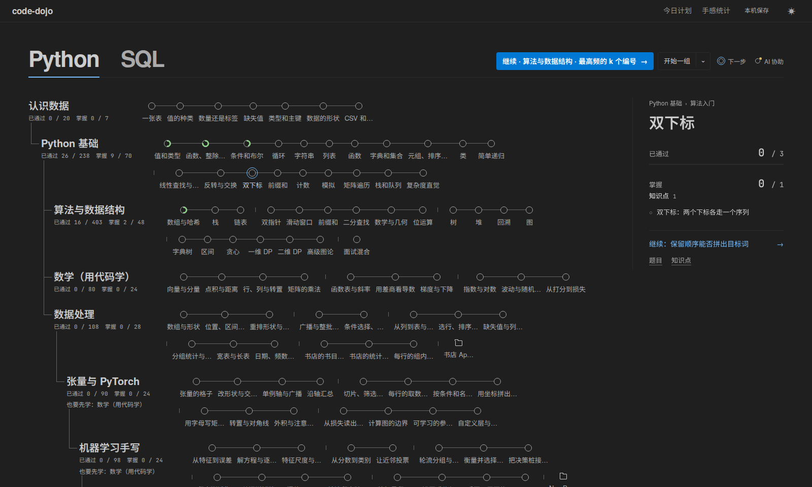

## Getting it

Download the installer for your platform from the latest [`app-v*` release](https://github.com/Rebas9512/code_dojo/releases/latest): an AppImage (or tar.gz) for Linux x86-64, a zip for Apple Silicon macOS, and a portable zip for Windows x64. The builds are unsigned, so macOS and Windows will ask you to confirm the first launch. Step-by-step instructions (in Chinese) are in [deploy/README.md](deploy/README.md#在一台新电脑上用).

- **Local by default.** No account, no password. On first launch the app downloads the problem bank from this repo's public releases, and checks for a newer bank each time it opens.
- **Progress stays on your machine**, in your user data folder. There's no telemetry.
- **Sync is for my own machines.** In *Desktop → Settings* I enter a sync code that unlocks access to my private progress repo, so I can continue on another computer. If you leave it empty, the app simply keeps your progress locally.

## Highlights

- **12 tracks, 1,620 problems, 7 capstone projects**, all checked by scripts: every reference solution runs in the judge, and the learning curve is validated so that each problem introduces at most one new skill.
- **Capstone projects**: the advanced tracks and the SQL tracks end with a project split into parts. Each part is one problem, judged on its own; together they assemble into a script or notebook that runs end to end.
- **Reference answers after you solve**: 1,366 problems have a clean, teaching-oriented standard solution with short notes. Once you've passed, you can open it and compare it with your own code in a diff view.
- **Practice sets and focus mode**: start a set of 3–8 problems, with due reviews as a warm-up. The app goes full screen with everything else folded away, and the next problem opens as soon as you pass.
- **A VS Code–style workspace**: statement and lesson on the left, Monaco editor in the middle, the AI tutor on the right, and test results / output / problems in a bottom panel. Every problem has a scratch file next to the answer. There's also a command palette, Ctrl+P quick open, and a "bare mode" that turns off autocomplete for interview-style practice.
- **An AI tutor that edits alongside you**: it sees your answer and your scratch file, and can write in either one. It can also generate new problems, which only appear after they pass verification. It uses Claude Code or Codex installed on your machine (see above), with no API keys.
- **Local judging**: Python runs natively with time and memory limits; SQL runs in the browser on PGlite, a WebAssembly build of PostgreSQL.

## Track design

All tracks start from **认识数据 (Meet the data)**, a short shared root about values, missing data, shapes, CSV and JSON. From there they branch:

```
认识数据 ─┬─ Python 基础 ─┬─ 算法与数据结构
          │              ├─ 数学（用代码学）──┐
          │              └─ 数据处理 ─────────┴─ 张量与 PyTorch ── 机器学习手写 ── 训练 ── 手搓 LLM
          └─ SQL ─┬─ 产品分析 SQL
                  └─ 建模与写数据
```

| Track | Problems | Stages |
|---|---:|---|
| Meet the data | 20 | the shared starting point |
| Python basics | 238 | syntax → beginner algorithms |
| Algorithms & data structures | 403 | data structures → core patterns → trees & graphs → advanced → mixed interview sets (NeetCode 250 skeleton) |
| SQL | 224 | single table → aggregation → joins → subqueries & CTEs → window functions → mixed (SQL 50 skeleton) → **project** |
| Product analytics SQL | 98 | metrics, funnels, retention, sessions, growth accounting, experiments, case studies → **project** |
| Modeling & writing data | 78 | DDL & constraints, inserts / merges / incremental loads, dimensional modeling, views & data quality → **project** |
| Math (with code) | 80 | vectors & matrices, functions & derivatives, logs & probability |
| Data wrangling | 108 | NumPy, broadcasting, pandas, groupby / merge / pivot, LeetCode-style SQL in pandas → **project** |
| Tensors & PyTorch | 90 | shapes, indexing & masks, einsum, autograd & `nn.Module` |
| ML from scratch | 98 | regression & gradient descent, classification, clustering & trees, evaluation, backprop & MLP → **project** |
| Training | 91 | data pipelines, training loops, evaluation & tuning, fixing broken training scripts → **project** |
| Build an LLM | 92 | tokenization → embeddings & attention → Transformer block → GPT forward & sampling → training & KV cache → **project** |

How the curriculum is built:

- **It assumes no prior knowledge.** Every skill has a short lesson with runnable, step-labelled examples and a mini-quiz, attached right next to the problems that use it.
- **Each problem introduces at most one new skill.** A skill graph tracks prerequisites. A checker script detects which syntax each reference solution actually uses (Python AST / SQL patterns), so solutions can't rely on anything not taught yet. The same check applies to the reference answers.
- **Each skill has its own ladder**: *predict* the output → *complete* the missing piece → *fix* a bug → *write* it from scratch → *variant* → *combine*. Predict problems target named misconceptions (for example "print is the same as return"), drawn from a misconception catalogue.
- **Interview skeletons**: NeetCode 250 for algorithms and SQL 50 for SQL, with small bridge problems before each new pattern. Problems that are LeetCode-premium were replaced with original problems of the same shape.
- **Mastery and review**: skills move from learning to mastered, and a daily plan mixes due reviews with new problems. A review can be a freshly generated variant, so you can't just recall the old answer. The **Continue** button takes you to the next unsolved problem after the furthest point you've reached on the track you practised most recently, so skipping ahead is fine.

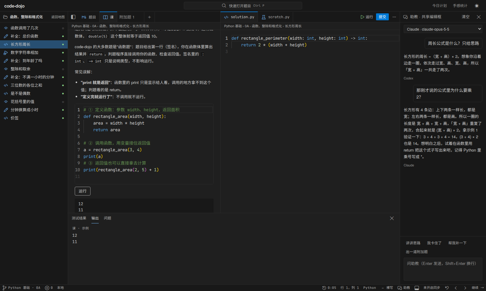

### Build an LLM (手搓 LLM)

This track goes from bytes to a small working GPT. Every step is checked exactly against reference implementations:

| Stage | What you build | Checked against |
|---|---|---|
| 1 Tokenization | bytes & characters, learning BPE merges, applying a vocabulary with document boundaries | exact token ids, e.g. `abab<end>ab` → `[257, 1000, 256]` |
| 2 Embeddings & attention | token + position embeddings, scaled dot-product attention, causal masks, splitting and merging heads | cell-by-cell outputs |
| 3 Transformer block | LayerNorm by hand, residuals, feed-forward, a pre-norm block | standard layers with fixed weights |
| 4 GPT forward & sampling | a full single-block GPT, temperature, top-k / top-p, stopping | all 32 logits at every position; seeded generation |
| 5 Training & KV cache | next-token training on a tiny corpus, a KV cache for incremental decoding | per-step losses; cached vs. uncached outputs |
| 6 Project | a character-level GPT trained on *Pride and Prejudice*: AdamW, warm-up + cosine schedule, sampling, KV-cache generation | validation loss < 2.0; both decoding paths agree |

The models are deliberately tiny, so a whole training run is judged on CPU. Problems are original; the approach follows [minbpe](https://github.com/karpathy/minbpe), [nanoGPT](https://github.com/karpathy/nanoGPT) and [LLMs-from-scratch](https://github.com/rasbt/LLMs-from-scratch).

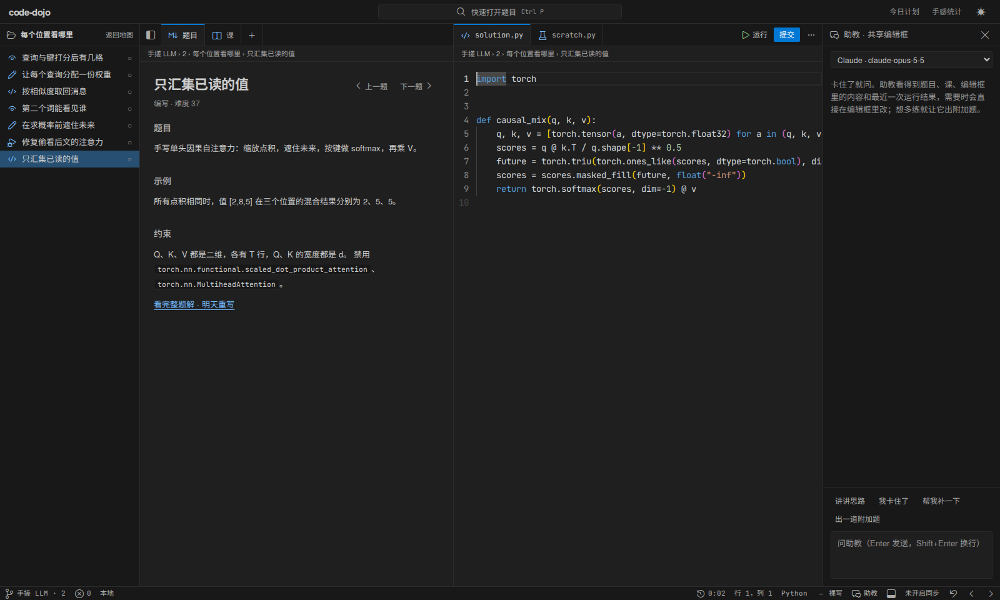

## Capstone projects

Seven tracks end with a project. Each part is a normal problem with its own tests; while you work on one part, the others are filled in with reference implementations, so each part can be judged on its own. Once every part has passed, the project page assembles your parts into one file, runs it end to end, and checks the result. You can export it as `.py` and `.ipynb` (Python) or `.sql`, and download the data to run it yourself.

| Track | Project | Parts | Passes when |
|---|---|---:|---|
| Data wrangling | **Reader features for a bookstore app**: clean three raw logs with pandas, split sessions, and write one row per reader with a churn label | 8 | exact row count, churn rate and 30-day spend |
| ML from scratch | **Churn prediction in NumPy**: logistic regression by hand on the table above, with scaling, gradients, F1, AUC and k-fold tuning | 11 | F1 ≥ 0.78 and AUC ≥ 0.86 on held-out readers |
| Training | **A standard PyTorch training script** on 8×8 handwritten digits: config & seeds, loaders, AdamW + scheduler, early stopping, checkpoints, logging, CLI | 11 | validation accuracy ≥ 0.95 |
| Build an LLM | **A character-level GPT**: vocabulary, batching, attention, blocks, training with validation loss, and generation with and without a KV cache | 12 | validation loss < 2.0, identical outputs from both paths |
| SQL | **A monthly bookstore report**: seven CTEs (valid orders, revenue, month-over-month change, category ranks, repeat buyers…) combined into one `WITH … SELECT` | 8 | matches the reference report row by row |
| Product analytics SQL | **A growth dashboard** for a reading app: sessions, DAU / WAU, an ordered funnel, cohort retention, growth accounting and an A/B readout | 8 | every check passes |
| Modeling & writing data | **A small warehouse**: raw loads, customer tier history (SCD2), a product dimension, facts keyed to the tier on the day of sale, a second batch merged in, an audit of unmatched rows, and closing the books | 8 | every check passes |

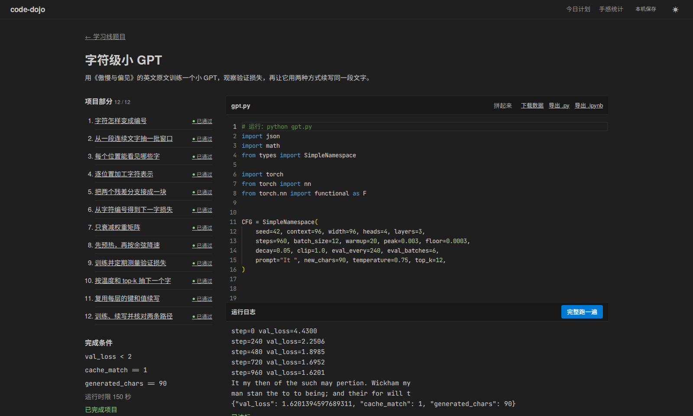

## Reference answers

After you've passed a problem, the **参考答案** tab shows a standard solution with short notes: the idea, its complexity, what makes it idiomatic, and sometimes a more advanced version. **和我的代码对比** opens a diff from your current code to the standard one, so a correct but clumsy answer can be tidied up line by line.

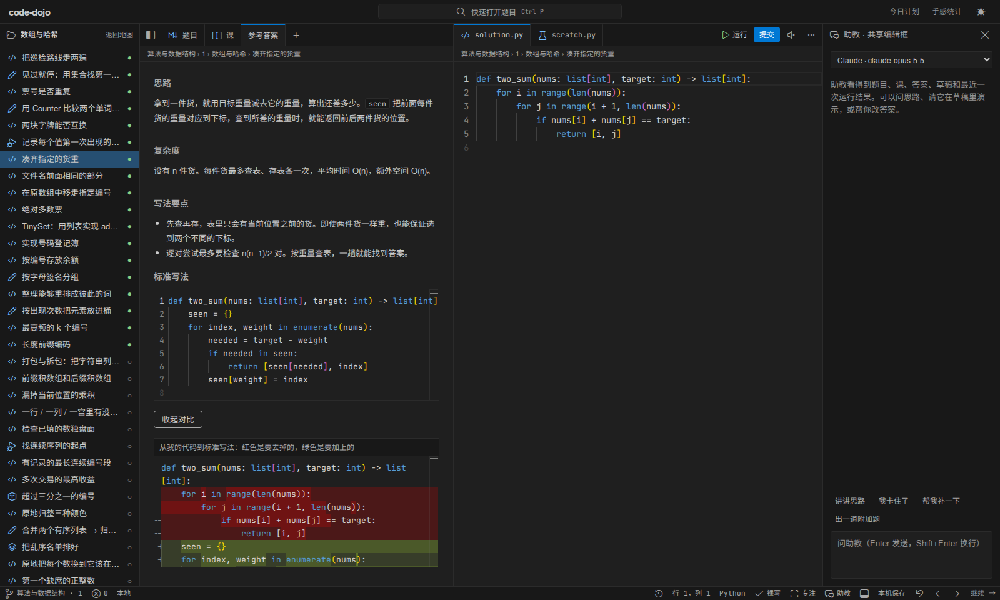

## Practice sets and focus mode

**开始一组** on the map starts a set of 3, 5 or 8 problems, optionally time-boxed to 25 or 45 minutes. Up to two due reviews come first as a warm-up, then new problems continue from where you are on the track. Starting a set turns on focus mode: the top bar, unit list and tutor fold away (Ctrl+Alt+I still brings the tutor back), and the app goes full screen. A small bar counts progress and first-try passes in a row, and the next problem opens 1.5 seconds after you pass. The clock stays hidden unless you hover over it, and a pass sound is available but off by default. At the end you get a summary of each problem with its time.

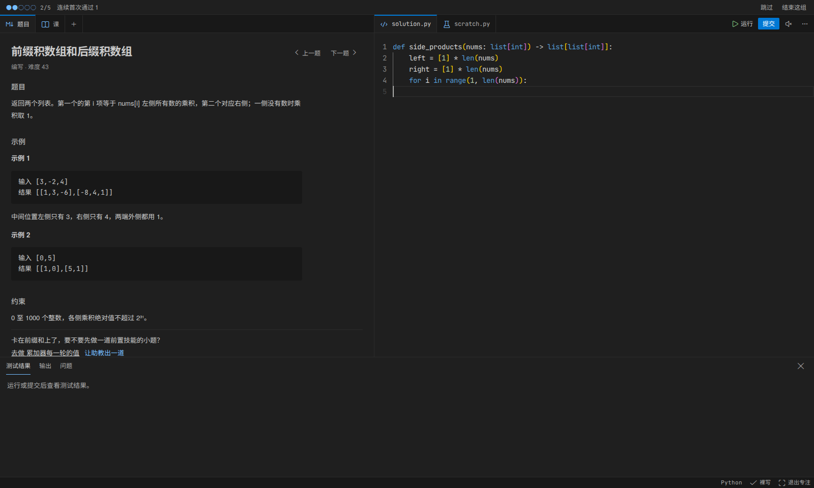

## AI-assisted solving and problem generation

> Requires [Claude Code](https://code.claude.com/docs/en/setup) or Codex installed and logged in on the same computer. The app detects them on launch, and *Desktop → Settings* shows whether the tutor is on.

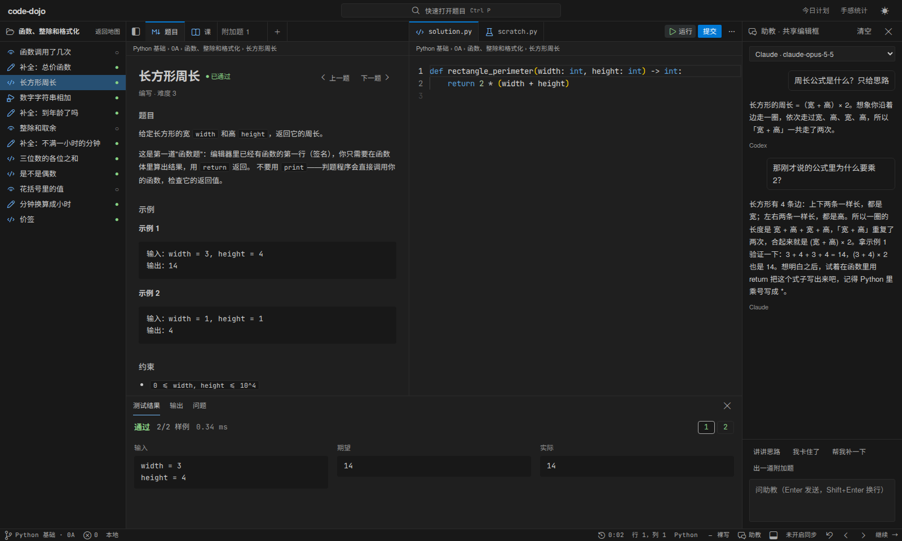

- **The tutor sees what you see**: the statement, the lesson, your answer, your scratch file and your last run. It explains in steps and gives graded hints rather than answers. Quick actions cover "explain the approach", "I'm stuck" and "fill in the next bit".
- **Shared editors**: the tutor's edits go straight into the answer or the scratch file, and can be undone with Ctrl+Z. Lines written by AI in the answer are counted, and a submission that used them is recorded as *AI-assisted* rather than solved on your own.
- **Demos in the scratch file**: ask it to show something ("print the intermediate values", "try it with other numbers") and it writes a small runnable example into the scratch file and switches you there. Scratch edits don't count as AI assistance, and the tutor is asked not to sneak the full solution in that way.
- **Pick your agent**: a dropdown lists the agents installed on the machine (Claude Code, Codex) and labels each reply with the agent that wrote it. Calls go through `claude -p` / `codex exec` with structured JSON output.
- **Extra problems on demand**: click ＋ or ask in the chat ("make it about strings"). The agent writes a new problem in the same style, and it only appears after it passes verification in the sandbox: the reference solution must pass every test, and typical wrong solutions must fail. This usually takes 15–20 seconds.
- **Drills when you're stuck**: if you keep failing on a skill, the tutor can generate a smaller drill. Static analysis checks that the drill uses only skills you've already mastered.

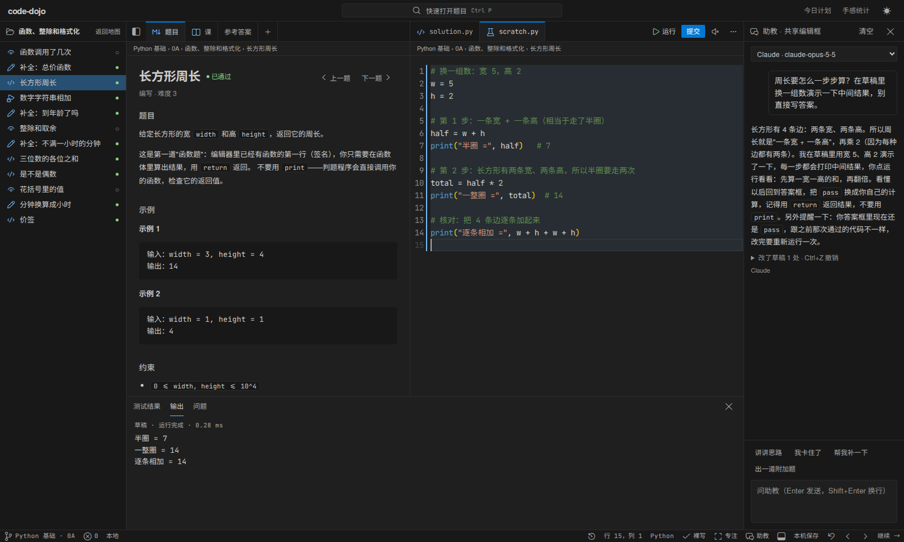

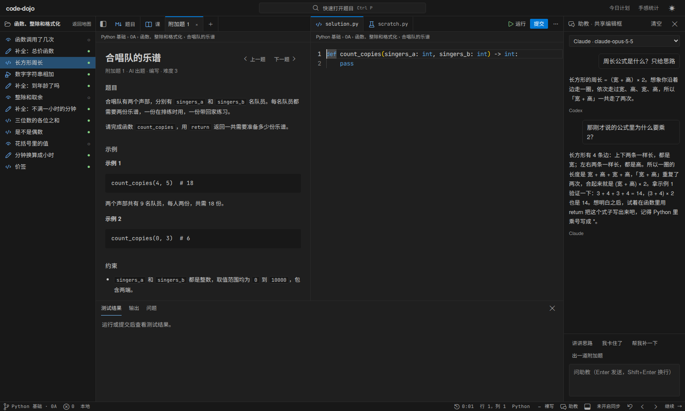

## More of the workspace

**A scratch file on every problem** (`scratch.py` / `scratch.sql`, Alt+S) for trying things out, including while you talk to the tutor. Ctrl+Enter shows its output; nothing is judged or recorded.

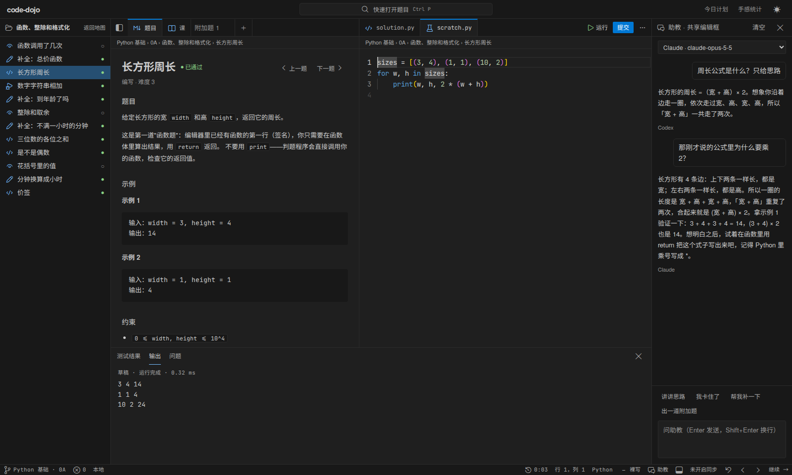

**SQL judged in the browser**, with your result and the expected result side by side. The SQL tracks run on a small bookstore database, plus an app-events schema for product analytics. They also include MySQL → PostgreSQL porting drills, where the starter query is real MySQL that fails on PostgreSQL.

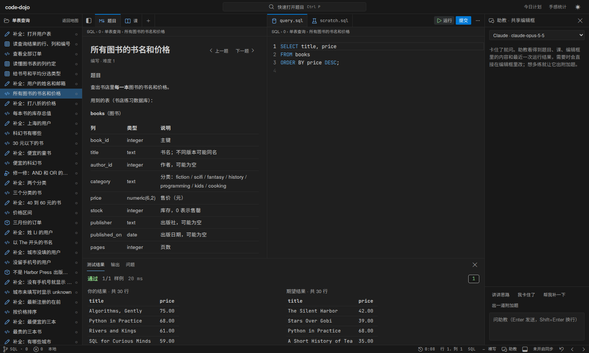

**Light theme**, with the same layout.


## Under the hood

- **Frontend**: React 19, Vite, TypeScript, Monaco, PGlite.
- **Backend**: FastAPI + SQLite. A local Python judge (CPython 3.14) with time and memory limits, plus optional Docker images, including NumPy / pandas / CPU PyTorch for the data-science tracks.
- **Desktop**: an Electron shell driving a Python launcher. GitHub Actions builds installers for all three platforms. Every push to `main` publishes a problem-bank "payload" release, which the app downloads anonymously on its next launch. Optional progress sync stores each machine's records as JSONL in a private repo. Its tokens ship encrypted in the installer (scrypt + AES-256-GCM), and the sync code unlocks them.
- **Content pipeline**: problems are plain files (YAML, Markdown, tests as JSON, SQL datasets). Checker scripts run every reference solution and reference answer, run each project end to end, precompute the expected SQL tables, and enforce the learning-curve rules.

Developer documentation is in Chinese: [docs/README.md](docs/README.md) (architecture and how to run), [docs/curriculum.md](docs/curriculum.md) (curriculum design), [docs/teaching-design.md](docs/teaching-design.md) (teaching design and the misconception catalogue), [docs/problem-format.md](docs/problem-format.md) (problem file format) and [deploy/README.md](deploy/README.md) (installing and releasing).

## License

No license is granted at this time. All rights reserved.
