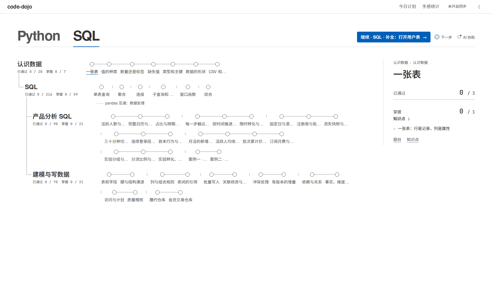

# code-dojo

**自用的手写代码练习场** · A personal practice app for getting my hands back on writing code: Python, algorithms, SQL, and machine learning built up from scratch, ending with a small GPT.

> **Status: personal use.** This repository is public as a showcase only. The app is wired to my own accounts: problem-bank updates come through this repo's releases, progress syncs to a private repo, and the AI tutor runs on my Claude / ChatGPT subscriptions. It isn't packaged for anyone else to install, and I'm not taking issues or pull requests. The UI and the problem text are in Chinese.


## Highlights

- **12 tracks, 1,554 problems**, all checked by scripts: every reference solution runs in the judge sandbox, and the learning curve is validated so that each problem introduces at most one new skill.
- **A VS Code–style workspace**: statement and lesson on the left, Monaco editor in the middle, the AI tutor on the right, and test results / output / problems in a bottom panel. There's also a command palette, Ctrl+P quick open, and a "bare mode" that turns off autocomplete for interview-style practice.
- **An AI tutor and AI-generated problems**, using Claude Code or Codex (whichever is installed) through my own subscription, with no API keys. A generated problem only appears after it passes verification in the sandbox.
- **Local judging**: Python runs natively with time and memory limits; SQL runs in the browser on PGlite, a WebAssembly build of PostgreSQL.
- **A desktop app** for Linux, macOS and Windows (Electron). It pulls the latest problem bank on launch and syncs progress across machines.

## Track design

All tracks start from **认识数据 (Meet the data)**, a short shared root about values, missing data, shapes, CSV and JSON. From there they branch:

```
认识数据 ─┬─ Python 基础 ─┬─ 算法与数据结构
          │              ├─ 数学（用代码学）──┐
          │              └─ 数据处理 ─────────┴─ 张量与 PyTorch ── 机器学习手写 ── 训练 ── 手搓 LLM
          └─ SQL ─┬─ 产品分析 SQL
                  └─ 建模与写数据
```

| Track | Problems | Stages |
|---|---:|---|
| Meet the data | 20 | the shared starting point |
| Python basics | 238 | syntax → beginner algorithms |
| Algorithms & data structures | 403 | data structures → core patterns → trees & graphs → advanced → mixed interview sets (NeetCode 250 skeleton) |
| SQL | 216 | single table → aggregation → joins → subqueries & CTEs → window functions → mixed (SQL 50 skeleton) |
| Product analytics SQL | 90 | metrics, funnels, retention, sessions, growth accounting, experiments, case studies |
| Modeling & writing data | 70 | DDL & constraints, inserts / merges / incremental loads, dimensional modeling, views & data quality |
| Math (with code) | 80 | vectors & matrices, functions & derivatives, logs & probability |
| Data wrangling | 100 | NumPy, broadcasting, pandas, groupby / merge / pivot, LeetCode-style SQL in pandas |
| Tensors & PyTorch | 90 | shapes, indexing & masks, einsum, autograd & `nn.Module` |
| ML from scratch | 87 | regression & gradient descent, classification, clustering & trees, evaluation, backprop & MLP |
| Training | 80 | data pipelines, training loops, evaluation & tuning, fixing broken training scripts |
| Build an LLM | 80 | tokenization → embeddings & attention → Transformer block → GPT forward & sampling → training & KV cache |

How the curriculum is built:

- **It assumes no prior knowledge.** Every skill has a short lesson with runnable, step-labelled examples and a mini-quiz, attached right next to the problems that use it.
- **Each problem introduces at most one new skill.** A skill graph tracks prerequisites. A checker script detects which syntax each reference solution actually uses (Python AST / SQL patterns), so solutions can't rely on anything not taught yet.
- **Each skill has its own ladder**: *predict* the output → *complete* the missing piece → *fix* a bug → *write* it from scratch → *variant* → *combine*. Predict problems target named misconceptions (for example "print is the same as return"), drawn from a misconception catalogue.
- **Interview skeletons**: NeetCode 250 for algorithms and SQL 50 for SQL, with small bridge problems before each new pattern. Problems that are LeetCode-premium were replaced with original problems of the same shape.
- **Mastery and review**: skills move from learning to mastered, and a daily plan mixes due reviews with new problems. A review can be a freshly generated variant, so you can't just recall the old answer.


### Build an LLM (手搓 LLM)

The last track goes from bytes to a small working GPT. Every step is checked exactly against reference implementations:

| Stage | What you build | Checked against |
|---|---|---|
| 1 Tokenization | bytes & characters, learning BPE merges, applying a vocabulary with document boundaries | exact token ids, e.g. `abab<end>ab` → `[257, 1000, 256]` |
| 2 Embeddings & attention | token + position embeddings, scaled dot-product attention, causal masks, splitting and merging heads | cell-by-cell outputs |
| 3 Transformer block | LayerNorm by hand, residuals, feed-forward, a pre-norm block | standard layers with fixed weights |
| 4 GPT forward & sampling | a full single-block GPT, temperature, top-k / top-p, stopping | all 32 logits at every position; seeded generation |
| 5 Training & KV cache | next-token training on a tiny corpus, a KV cache for incremental decoding | per-step losses; cached vs. uncached outputs |

The model is deliberately tiny (32-token vocab, context 16, width 48, 4 heads), so a whole training run is judged on CPU in a few seconds. Problems and corpora are original; the approach follows [minbpe](https://github.com/karpathy/minbpe), [nanoGPT](https://github.com/karpathy/nanoGPT) and [LLMs-from-scratch](https://github.com/rasbt/LLMs-from-scratch).


## AI-assisted solving and problem generation


- **The tutor sees what you see**: the statement, the lesson, your code and your last run. It explains in steps and gives graded hints rather than answers. Quick actions cover "explain the approach", "I'm stuck" and "fill in the next bit".
- **A shared editor**: the tutor's suggested edits are applied directly to your code and can be undone with Ctrl+Z. Lines written by AI are counted, and a submission that used them is recorded as *AI-assisted* rather than solved on your own.
- **Pick your agent**: a dropdown lists the agents installed on the machine (Claude Code, Codex) and labels each reply with the agent that wrote it. Calls go through `claude -p` / `codex exec` with structured JSON output.
- **Extra problems on demand**: click ＋ or ask in the chat ("make it about strings"). The agent writes a new problem in the same style, and it only appears after it passes verification in the sandbox: the reference solution must pass every test, and typical wrong solutions must fail. This usually takes 15–20 seconds.
- **Drills when you're stuck**: if you keep failing on a skill, the tutor can generate a smaller drill. Static analysis checks that the drill uses only skills you've already mastered.


## More of the workspace

**A scratch pad** next to the answer file (Alt+S) for trying things out. It only shows output: no judging, and nothing is recorded.


**SQL judged in the browser**, with your result and the expected result side by side. The SQL tracks run on a small bookstore database, plus an app-events schema for product analytics. They also include MySQL → PostgreSQL porting drills, where the starter query is real MySQL that fails on PostgreSQL.


**Light theme**, and a "continue" button that jumps to the next unsolved problem at your frontier on the most recently practised track.



## Under the hood

- **Frontend**: React 19, Vite, TypeScript, Monaco, PGlite.
- **Backend**: FastAPI + SQLite. A local Python judge (CPython 3.14) with time and memory limits, plus optional Docker images, including NumPy / pandas / CPU PyTorch for the data-science tracks.
- **Desktop**: an Electron shell driving a Python launcher. Installers are built for all three platforms by GitHub Actions. Every push to `main` publishes a problem-bank "payload" release that the app picks up on next launch. Progress syncs as per-machine JSONL to a private repo.
- **Content pipeline**: problems are plain files (YAML, Markdown, tests as JSON, SQL datasets). Checker scripts run every reference solution, precompute the expected SQL tables, and enforce the learning-curve rules.

Developer documentation is in Chinese: [docs/README.md](docs/README.md) (architecture and how to run), [docs/curriculum.md](docs/curriculum.md) (curriculum design), [docs/teaching-design.md](docs/teaching-design.md) (teaching design and the misconception catalogue), and [docs/problem-format.md](docs/problem-format.md) (problem file format).

## License

No license is granted at this time. All rights reserved.
